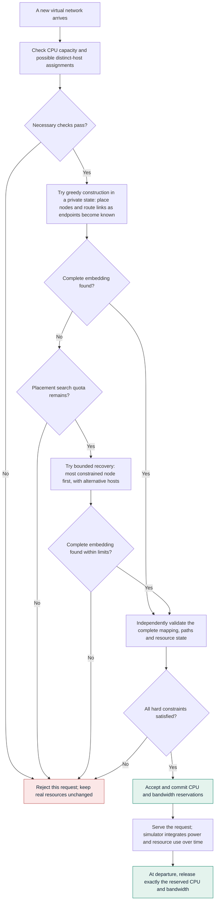
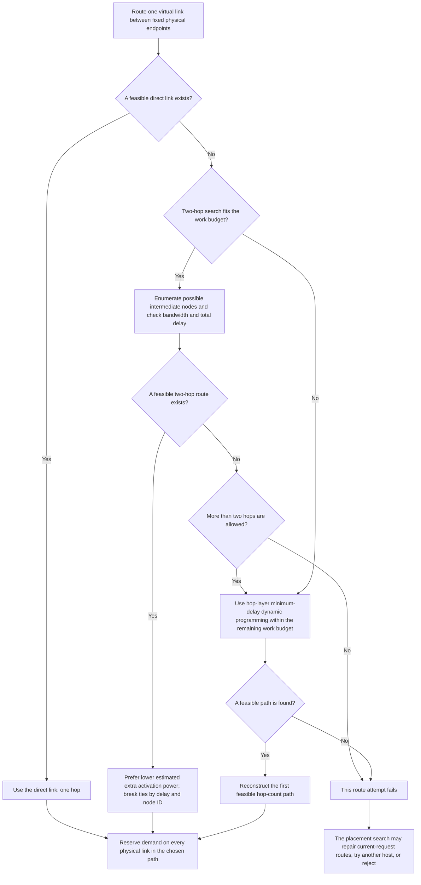
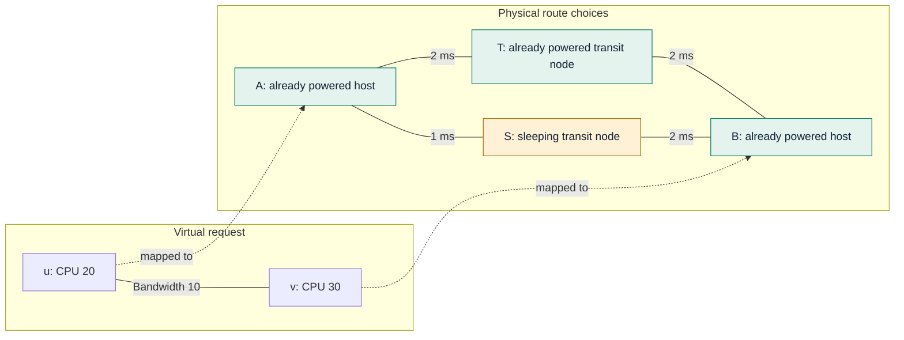
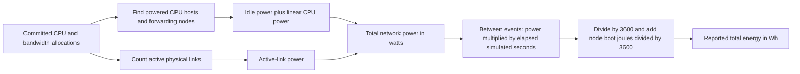
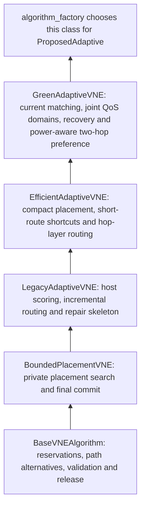

# Understanding your proposed VNE algorithm

This guide explains the maintained code as checked on **9 October 2026**. The experiment name is **`ProposedAdaptive`**. Its implementation is **`GreenAdaptiveVNE`**; the public name `ProposedAdaptiveVNE` points to the same class.

**Your algorithm places each arriving virtual network onto the available physical network. It tries a quick greedy construction first, then limited recovery. It combines feasibility checks, resource headroom, power-aware host choices, compact placement and short feasible routes.**

The flowcharts use Mermaid. GitHub and Markdown viewers with Mermaid support render them as diagrams. The surrounding explanations also describe every step in plain text.

## 1. What problem are you solving?

Imagine the physical network as a set of computers connected by communication links. A customer asks for several virtual computers and connections between them. Your algorithm must decide where to put the virtual computers and how to connect them.

| Term | Meaning in your code |
|---|---|
| Substrate / physical network | The infrastructure available to all requests. |
| Virtual network request, or VNR | A graph of virtual nodes with CPU demands and virtual links with bandwidth demands. |
| Node placement | Assigning a physical host to each virtual node. |
| Link routing | Assigning one physical path to each virtual link. |
| Residual capacity | CPU or bandwidth still available after earlier accepted requests. |
| Injective placement | Different virtual nodes **inside one request** must use different physical hosts. Different requests may share a host if capacity permits. |
| Unsplittable routing | A virtual link uses one path. Its bandwidth demand is reserved on **every physical link** in that path. |
| Delay and hop constraints | A chosen path must fit both the total delay limit and maximum number of physical links. |

An accepted request keeps its resources until departure. Earlier accepted requests are not moved to make room for a new one.

The online policy uses current resource availability. It does not know future arriving requests, solve the whole future trace, or compute a globally optimal schedule.

## 2. The complete decision process



Placement and routing are interleaved. The algorithm does **not** place every node first and only then discover whether the links fit. Each time it places a node, it routes the virtual links whose two endpoints are now placed.

All exploration uses copies of the current resource state. Failed alternatives do not consume real CPU or bandwidth. Only a validated complete solution is committed.

### Step A: avoid searching requests that fail necessary conditions

Before the placement search, the current implementation checks:

1. **CPU matching:** sort virtual CPU demands and physical residual CPU capacities. If the demands cannot fit on distinct hosts even when links are ignored, reject.
2. **Local host-domain matching:** build possible hosts using CPU and optimistic incident-link checks. Try to assign a different host to every virtual node in these relaxed domains.

For example, virtual CPU demands `[10, 10]` cannot fit injectively onto physical residual capacities `[20, 5]`. There is enough total CPU, but only one host can accommodate a demand of 10.

These checks certify failure of their relaxed conditions. **Passing them does not prove that all virtual links can be routed together.**

### Step B: try the inexpensive construction first

The initial virtual-node order favors larger CPU demands, then higher degree. For this first pass, the algorithm considers one top candidate host per placement stage.

It still applies feasibility checks and routes newly closed links. A routing failure can invoke limited route repair. The first pass is therefore more than CPU-only greedy placement.

If it finds a complete embedding, the algorithm commits it immediately after validation. It does not continue searching for a globally cheaper embedding.

### Step C: recover from a failed first construction

If placement quota remains, the algorithm changes the order of the remaining virtual nodes. It prioritizes the node with the fewest possible hosts. Ties favor more links to already placed nodes, larger incident bandwidth, then larger CPU demand.

The purpose is to place difficult nodes before easier choices occupy their few available hosts. This recovery can explore up to eight eligible host candidates at a stage, within the overall placement-state quota.

**The greedy pass and recovery share the same placement quota. Recovery does not receive a fresh extra quota.**

## 3. How does it choose a physical host?

The algorithm filters unsuitable hosts, then ranks the remaining ones. Higher host scores are preferred.

| Component | What it asks | Why it is included |
|---|---|---|
| CPU feasibility and distinctness | Can this host fit the demand, and is it unused by another virtual node in this request? | Enforce hard placement constraints. |
| Incident-link checks | Could the required outgoing bandwidth leave this host? | Avoid obvious communication bottlenecks. |
| Joint hop/delay domains | Could a link reach an already placed neighbor within **both** limits? | Avoid selecting a host based on incompatible separate hop and delay paths. |
| CPU headroom | How much normalized CPU remains after placement? | Preserve usable capacity. |
| Link quality | Do suitable first-hop links have bandwidth headroom, acceptable delay and useful proximity? | Favor hosts with useful communication options. |
| Marginal host power | Would this host need waking? How much CPU power would the demand add? | Prefer cheaper additional power where other conditions permit. |
| Compact placement | How far is this host from already placed virtual neighbors, weighted by their bandwidth demands? | Discourage unnecessary physical link consumption. |

### The placement score, in readable form

```text
host score = (1 - energy weight) × resource quality
             - energy weight × marginal host power
             - compact-placement penalty
```

The score is a heuristic tradeoff, not energy measured in Wh and not a globally optimized objective.

Resource quality combines normalized remaining CPU and bandwidth-weighted link profiles. CPU and bandwidth contributions receive more weight as their respective resource pools become occupied.

The default adaptive energy weight is:

```text
pressure = maximum of current CPU pressure and bandwidth pressure
energy weight = 0.60 × (1 - 0.45 × pressure)
```

For valid states, this moves approximately from **0.60** at zero pressure to **0.33** at full pressure. Under greater resource pressure, the policy gives relatively more importance to resource quality. Pressure is computed from resource occupancy, not directly from the configured arrival rate.

For a physical host of CPU capacity `C` and a virtual CPU demand `d`:

```text
extra CPU power = (P_peak - P_idle) × d / C

wake proxy = 0, if the host is already considered powered
             P_idle + boot_energy / 500 seconds, otherwise

marginal host power score = (wake proxy + extra CPU power) / P_peak
```

The **500 seconds is a fixed scoring assumption**. It is not the new request's measured lifetime or a forecast of how long the host will stay powered.

The compact penalty is `0.30` times a bandwidth-weighted average of `max(estimated hops - 1, 0)` to already mapped virtual neighbors. These hop estimates are optimistic. They guide ranking; they do not certify complete routing feasibility.

### Why joint hop/delay checks matter

Suppose a host can reach a destination in two hops, but that route takes 40 ms. A different route takes 15 ms but needs five hops. For a request limited to three hops and 25 ms, neither route fits.

Checking only the best hop count and best delay separately could pass this host. Your current code instead builds minimum-delay bounds for paths using at most each allowed hop count. It checks whether the same relaxed route can satisfy both restrictions.

These bounds use the bandwidth available **at request arrival**. Tentative routes within the new request may later be repaired, so the algorithm avoids treating their temporary bandwidth use as a permanent impossibility.

### What does exact first-hop packing check?

Each positive incident virtual-link demand must fit onto one eligible outgoing physical link, or port. Several virtual links can share a port only if their total bandwidth fits.

Consider two ports with capacities `[10, 10]` and three incident demands `[8, 7, 5]`. The total demand is 20 and total port capacity is 20, but no unsplit assignment fits: no pair of those demands can share a port of capacity 10. Exact local packing rejects this candidate.

The code first tries to construct a packing. If that fails, it uses exhaustive subset dynamic programming for small incident-demand sets. **A failed greedy packing alone is never grounds for rejection.**

By default, exact packing is limited to ten positive incident demands. Above this degree, it is bypassed rather than interpreted as infeasibility. It is evaluated as candidates are considered, avoiding unnecessary work on lower-ranked hosts.

A successful packing proves only that the outgoing first hops can fit. The rest of the paths may still compete for shared physical links.

## 4. How does routing work?

For newly closed virtual links, the fast route batch tries one route per link. Larger bandwidth demands are handled first. Every reservation updates the private residual bandwidth state before the next link is routed.



The direct-link and exhaustive two-hop shortcuts avoid expensive longer-path processing in common cases. Their work still counts against the path-search budget.

For longer paths, the dynamic program tracks the smallest delay achievable at each node with exactly a given number of hops. The first destination layer satisfying the delay cap gives the minimum feasible hop count **when the budget permits a complete search**. Nonnegative physical delays are required.

### Where is routing power-aware?

Among feasible two-hop routes, the preference is approximately:

```text
extra activation power = intermediate-node wake proxy
                         + power of newly activated route links
```

An already powered intermediate node is preferable to a sleeping one when it gives a lower activation-power estimate. Delay is the next tie-breaker.

**This is not a global lifetime-energy optimizer.** Direct paths prioritize feasible one-hop routing. The longer-path dynamic program prioritizes minimum feasible hops and minimum delay in its layers; it does not optimize integrated energy across all longer paths. Repair alternatives are ranked by hop count and delay.

### What happens if independently chosen routes conflict?

If the new-link batch fails, joint repair can reconsider the currently closed virtual links of this request with up to three route alternatives per link. This can change earlier tentative routes of the **same arriving request**.

By default, joint repair is skipped when the closed-link set contains more than four virtual links. Placement recovery can then try another host. This cap is a runtime policy, not proof that larger requests are infeasible.

Previously accepted requests keep their mappings and routes. Repair is not migration of existing customers.

## 5. A small example you can follow

**The following is an illustrative example, not an output from your full experiments.**

A request asks for two virtual nodes: `u` needs 20 CPU units and `v` needs 30. Their virtual link needs 10 bandwidth units. Its delay limit is 25 ms and hop limit is eight. Its lifetime is 300 seconds.

Suppose one feasible host assignment is `u → A` and `v → B`. Both hosts have CPU capacity 100 and are already powered. Their current residual CPUs are 60 and 70 respectively. The assignment leaves 40 CPU units on each host.

There is no direct A–B link. Two possible routes have sufficient bandwidth:



Assume each route's physical links are currently inactive, each link has capacity 20, and T stays powered by background work for all 300 seconds.

| Route | Hops | Delay | Intermediate node | Two-hop activation-power key |
|---|---:|---:|---|---:|
| A–T–B | 2 | 4 ms | Already powered | `2 × 5 = 10 W` |
| A–S–B | 2 | 3 ms | Sleeping | `150 + 50/500 + 2 × 5 = 160.1 W` |

Both routes satisfy the QoS limits. The current two-hop preference chooses **A–T–B**, despite its slightly higher delay, because its activation-power key is lower.

The two CPU allocations add `200 × (20/100 + 30/100) = 100 W`. The two newly active physical links add another 10 W. With these fixed background assumptions, the first route adds:

```text
additional energy = 110 W × 300 s / 3600 = 9.167 Wh
```

The sleeping-transit alternative additionally wakes S, adding 150 W while it is needed and a 50 J boot charge:

```text
additional energy = (110 + 150) W × 300 s / 3600 + 50 J / 3600
                  = 21.681 Wh
```

These are **additional energies in this toy example**, excluding background energy. The full experiment reports total network energy, including background accepted requests. If T's background work ended earlier, the comparison would change; the production route key does not predict that future activation duration.

## 6. How energy is actually accounted for

The host/routing scores guide decisions. A separate simulator integrates the resulting network power over time.



For a powered physical node:

```text
node power = P_idle + (P_peak - P_idle) × used_CPU / CPU_capacity
```

For the network:

```text
network power = sum of powered-node powers + P_link × active_link_count
energy_Wh = sum of network_power × event_interval_seconds / 3600
            + total_boot_joules / 3600
```

The latest full run uses `P_idle = 150 W`, `P_peak = 350 W`, `P_link = 5 W` and a 50 J charge per node wake transition. A forwarding-only node has no allocated virtual CPU, but still incurs 150 W idle power while forwarding.

Empty infrastructure is treated as asleep. Wake latency, cooldown, separate server/switch models and migration are not modeled. Carbon emissions and the electricity used by the computer running Python are not measured.

**Faster embedding code does not directly reduce the reported substrate energy.** It must change the accepted workload or physical allocations to affect this modeled energy.

## 7. Why can good acceptance come with high total energy?

Accepting more requests keeps more CPU hosts and communication links occupied, often for longer. A method that rejects many requests can have lower total energy while delivering less service.

This does not make every energy disadvantage harmless. Placement can still keep too many nodes active, and a short path can still wake a transit node. Your policy does not minimize the whole network's energy over request lifetimes.

Different denominators answer different questions:

| Metric | Question it answers |
|---|---|
| Acceptance | What fraction of arriving requests was admitted? |
| Total energy | How much modeled energy did this network consume during the horizon? |
| Energy/accepted request | How much total energy per admitted request? Request sizes and lifetimes still differ. |
| Energy/served request-second | How much total energy per second of delivered request service? |
| Energy/served CPU-unit-second | How much total energy per unit of delivered CPU service over time? |
| Energy/served bandwidth-unit-second | How much total energy per unit of delivered end-to-end virtual bandwidth service over time? |
| Mean embedding time | How long did an embedding attempt take, including rejected attempts? |
| P95/P99 embedding time | How slow were the higher-latency attempts? |
| Mean hops | How many physical links were used per routed virtual link? |
| Revenue/cost | Requested virtual CPU plus virtual bandwidth, divided by CPU plus bandwidth reserved over physical hops. These are resource sums, not monetary profit. |

Served bandwidth here counts virtual bandwidth demand over time, **not** bandwidth multiplied by physical hop count. Physical hop consumption contributes to embedding cost and physical-link utilization instead.

In the latest full run, your proposal ranks first in mean acceptance and CPU/bandwidth service-normalized energy, but last in total energy. Its mean embedding-time rank is sixth. Those results support specific tradeoffs, not a claim of winning every metric or solving VNE optimally.

## 8. How the implementation keeps computation manageable

| Mechanism | What it saves |
|---|---|
| Early injective matching | Avoids placement/routing search when relaxed distinct-host assignments already fail. |
| Greedy first pass | Avoids broader host exploration on requests solved by the first construction. |
| Domain-membership ordering | Counts feasible host membership for recovery without computing every remaining node's full host scores. |
| Request-local caches | Reuses QoS layers, link profiles and compatible score contexts during one arrival. Caches are cleared between requests. |
| Conditional batch scoring | Evaluates the same scalar host formula with arrays when there are at least 16 eligible hosts and the fast scoring path applies. Smaller domains retain scalar scoring. |
| On-demand exact packing | Checks packing as candidate hosts are considered, rather than exhaustively testing every scored host first. |
| Direct/two-hop routing | Solves common short-route cases before longer-path dynamic programming. |
| Limited joint repair | Keeps route retries small instead of jointly rerouting every growing link set. |
| Validated private reservations | Reuses trusted internal state transitions while retaining independent complete validation at commit. |

### Current default limits

| Setting | Default | Interpretation |
|---|---:|---|
| Placement search budget | 24 | Recursive placement-state visits, shared by greedy and recovery passes, including terminal states. |
| Candidate limit | 8 | Maximum eligible host alternatives explored at a placement stage during recovery. The greedy pass temporarily uses one. |
| Route budget | 24 | Route-state quota for a routing/repair batch, including its terminal state. It is not one global quota for every route call in the whole request. |
| Path expansion budget | 240 | Work quota for an individual path search. Shortcuts consume work too. It does not count every primitive array operation. |
| Repair path alternatives | 3 | Maximum generated alternatives per virtual link in joint repair. The normal incremental attempt uses one. |
| Exact packing degree limit | 10 | Maximum positive incident demands for the exact local packing check. Larger sets bypass that check. |
| Joint repair link limit | 4 | Maximum closed virtual links eligible for the default joint repair attempt. |
| Base energy weight | 0.60 | Adapted downwards with resource pressure. |
| Compact placement weight | 0.30 | Weight on estimated bandwidth-weighted extra hops to mapped neighbors. |
| Boot amortization | 500 seconds | Fixed power-scoring proxy; actual accounting separately charges boot joules. |

These are work policies, not millisecond limits or optimality guarantees. A rejection after a search limit can mean that the algorithm did not find an embedding, even though another placement might have worked.

## 9. Where each part lives in your code

The implementation is layered. The current proposal inherits useful mechanics from older classes and overrides the important placement/routing decisions. The presence of inherited code does not mean that the factory runs several proposals simultaneously.



| Source | What to look for |
|---|---|
| [green.py](<C:/Users/Mark/Desktop/VNE arko/vne/green.py>) | `embed`, `_local_matching_possible`, `_joint_delay_layers`, `_host_scores`, `_backtrack`, `_two_hop_key`. |
| [efficient.py](<C:/Users/Mark/Desktop/VNE arko/vne/efficient.py>) | Compact link profiles and placement penalty, direct/two-hop shortcuts, longer-route dynamic programming, repair size cap. |
| [algorithms.py](<C:/Users/Mark/Desktop/VNE arko/vne/algorithms.py>) | Inherited scoring/search/repair mechanics, atomic `commit_embedding`, release, and `algorithm_factory`. |
| [pruning.py](<C:/Users/Mark/Desktop/VNE arko/vne/pruning.py>) | The constructive packing witness and exact subset packing check. |
| [models.py](<C:/Users/Mark/Desktop/VNE arko/vne/models.py>) | CPU/bandwidth state, powered nodes, active links and power formula. |
| [experiments.py](<C:/Users/Mark/Desktop/VNE arko/vne/experiments.py>) | Arrival/departure processing, energy integration, service counters and timing. |

## 10. What you can confidently say about your proposal

> Our proposal is a bounded online VNE heuristic that combines necessary host-domain matching, joint hop/delay feasibility checks, power-aware compact host placement, greedy construction with constrained-node recovery, and power-aware preference among feasible two-hop routes. Hard resource and QoS constraints are validated before an embedding is committed.

That describes the implemented behavior. It does not establish that each ingredient is new, that every feasible request will be admitted, or that the combined algorithm minimizes total energy. Necessary pruning checks and a minimum-hop single-link subroutine do not turn the whole VNE problem into an exact solver.

For understanding the current evidence, use the [latest full-run verdict](<C:/Users/Mark/Desktop/VNE arko/results/full_revision_2026-10-08_30_3_50PM/analysis/VERDICT.md>) and [reference fidelity notes](<C:/Users/Mark/Desktop/VNE arko/REFERENCES.md>). Several recorded controls use older engines and differ in multiple settings; their names alone do not make them isolated ablations of the current proposal.

Version anchor: the simulator source fingerprint checked for this guide is `0a1910fbd0c4322a842490b72a07beb591ff7c541b02a6b1c089d54fad73bbc9`. This guide changes documentation only; it does not change policy, test scenarios or experiment results.
